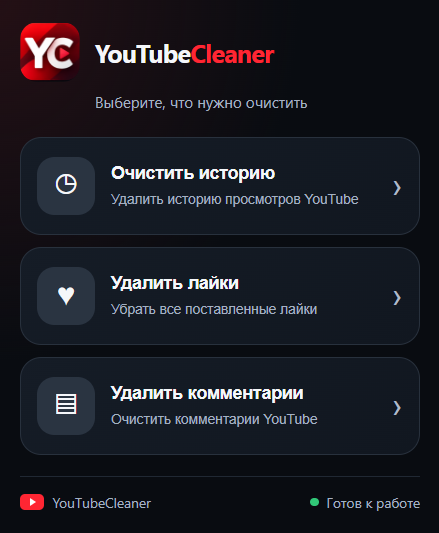

# YouTubeCleaner

**YouTubeCleaner** — простое расширение для Microsoft Edge, позволяющее автоматически очищать данные активности YouTube.

### Возможности

- **Удаление комментариев** — автоматическое удаление всех найденных комментариев YouTube. Чем больше комментариев, тем дольше длится процесс. Можно запустить очистку и заниматься своими делами — после завершения вкладка закроется автоматически.
- **Удаление лайков** — удаление поставленных отметок «Нравится».
- **Очистка истории** — удаление истории активности за всё время.
- **Автоматизация** — расширение самостоятельно выполняет необходимые действия и закрывает вкладку после завершения.

### Установка

1. Перейдите в раздел [Releases](../../releases) и скачайте архив `YouTubeCleaner-1.0.0.zip`.
2. Распакуйте архив в удобную папку, которую не планируете удалять или перемещать.
3. Откройте Microsoft Edge и перейдите по адресу `edge://extensions/`.
4. Включите **«Режим разработчика»**.
5. Нажмите **«Загрузить распакованное»**.
6. Выберите папку расширения, содержащую файл `manifest.json`.

После установки при желании закрепите YouTubeCleaner на панели браузера.

### Использование

Нажмите на значок **YC** на панели Edge и выберите необходимое действие:

- Удалить комментарии
- Удалить лайки
- Очистить историю

Расширение откроет страницу Google My Activity и автоматически выполнит выбранное действие.

### Важно

- Удалённые данные могут быть невосстановимы.
- Для работы необходим вход в аккаунт Google.
- Расширение рассчитано на русскоязычный интерфейс Google My Activity.
- Изменения интерфейса Google могут повлиять на работу автоматизации.
- На данный момент расширение протестировано в Microsoft Edge.